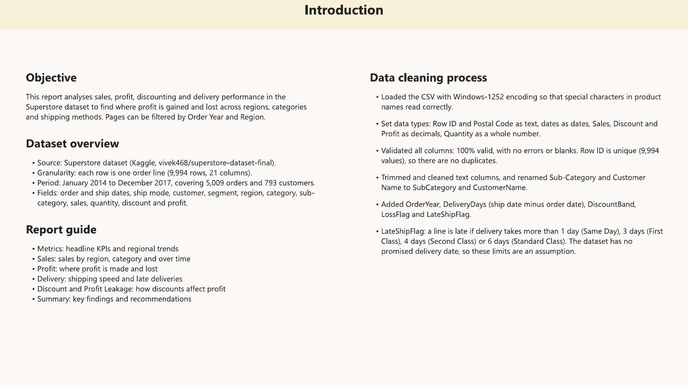
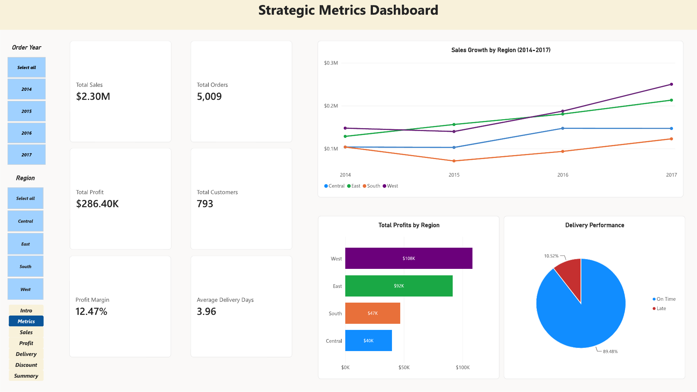
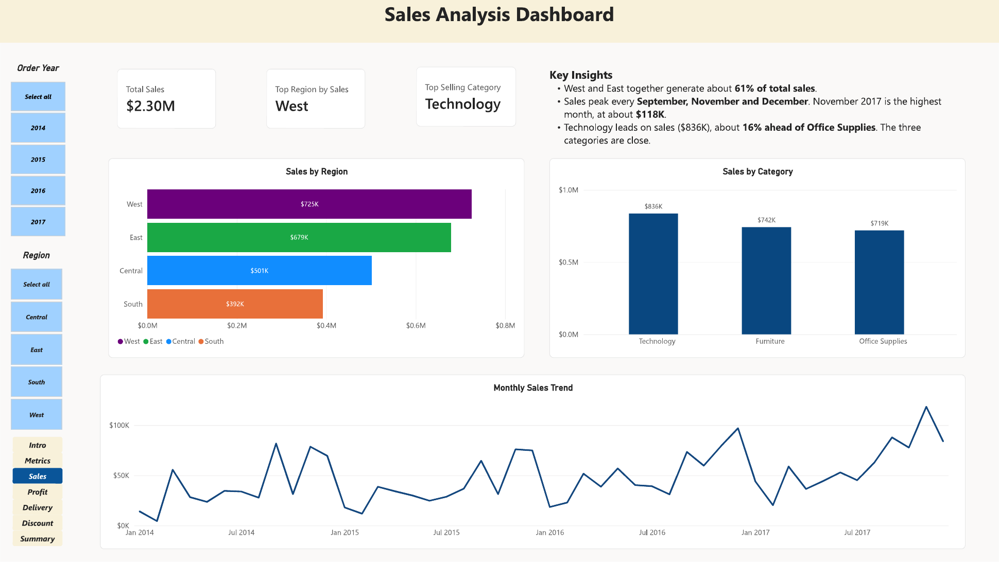
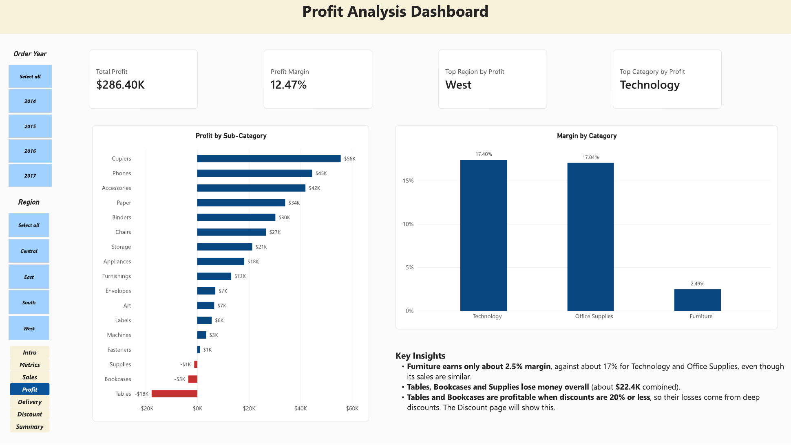
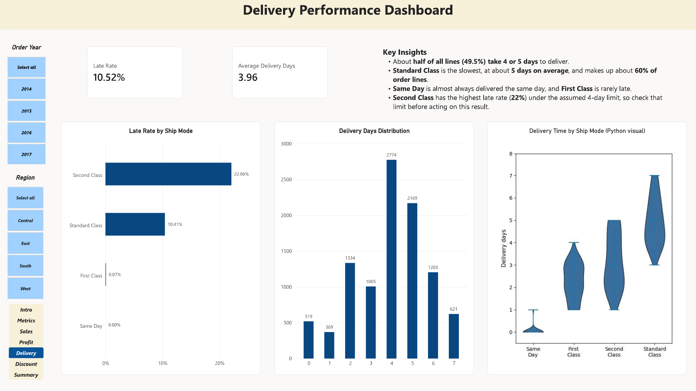
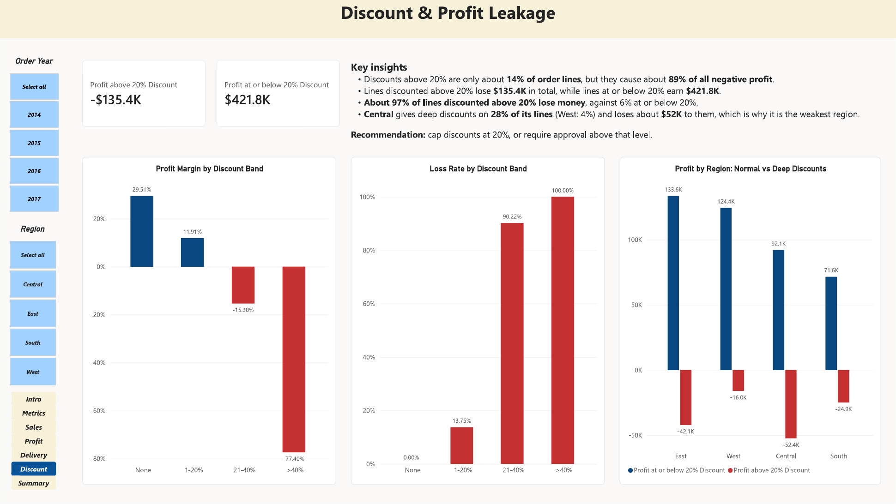
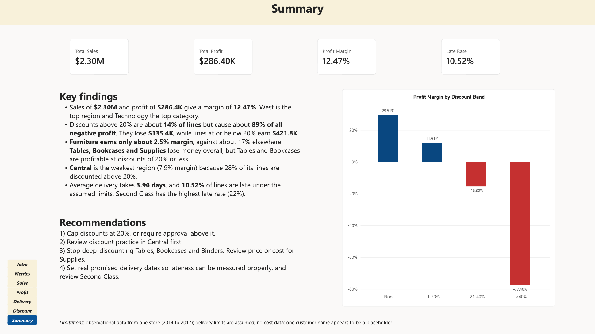
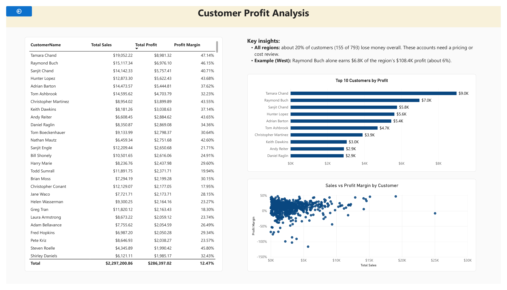
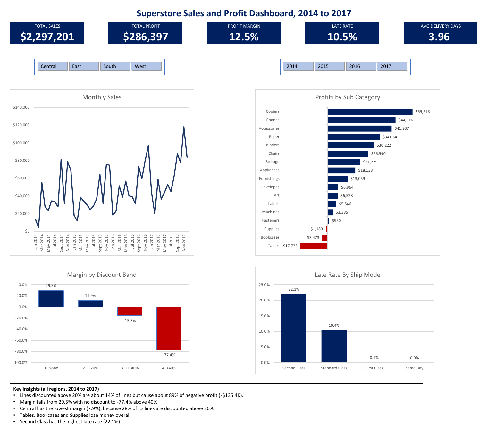

# Superstore Capstone: Where Does Profit Leak?

A Power BI dashboard (with one Python visual) and a matching Excel dashboard analysing sales, profit, discounting and delivery performance for a retail superstore, 2014 to 2017.

**Author:** Siti Rakhawati

**Tools:** Power BI Desktop (Power Query, DAX), Python (matplotlib) for one custom visual, Excel (Power Query, PivotTables, slicers)

**Data:** [Superstore Dataset (Kaggle, vivek468/superstore-dataset-final)](https://www.kaggle.com/datasets/vivek468/superstore-dataset-final), 9,994 order lines, 21 columns


---

## Business question

Sales grew from 2015 to 2017, but the overall profit margin is only 12.47%. **Where is profit being lost, and what should the business change?**

## Key findings

| Finding | Evidence |
|---|---|
| **Deep discounts cause most of the losses.** | Lines discounted above 20% are about 14% of order lines but cause about 89% of all negative profit. They lose **$135.4K**, while lines at or below 20% earn **$421.8K**. About 97% of lines above 20% lose money, against 6% at or below. |
| **Central is the weakest region because of discounting.** | Central margin is 7.9%. 28% of its lines are discounted above 20% (West: 4%), costing about $52K. |
| **Furniture is the weakest category.** | Margin of about 2.5%, against about 17% for Technology and Office Supplies. |
| **Tables, Bookcases and Supplies lose money overall (about $22.4K).** | Tables and Bookcases are profitable at discounts of 20% or less, so their losses come from deep discounts. |
| **Delivery:** average 3.96 days; 10.52% of lines are late under the assumed limits. | Second Class has the highest late rate (22%). |

Headline numbers: **$2.30M sales, $286.40K profit, 12.47% margin, 5,009 orders, 793 customers.**

## Recommendations

1. Cap discounts at 20%, or require approval above it.
2. Review discount practice in Central first.
3. Stop deep-discounting Tables, Bookcases and Binders. Review price or cost for Supplies.
4. Set real promised delivery dates so lateness can be measured properly, and review Second Class.

---

## Dashboard pages

Open `dashboard/Rebuild Capstone.pdf` to see every page, or `dashboard/Rebuild Capstone.pbix` in Power BI Desktop for the interactive version (slicers, drill-through).

### Intro


### Metrics


### Sales


### Profit


### Delivery (includes the Python visual)


### Discount & Profit Leakage


### Summary


### Customers (drill-through from Region)


## Excel dashboard (same data, rebuilt in Excel)

To show the same analysis can be done without Power BI, I rebuilt the dashboard in Excel. The headline numbers match the Power BI version.



Files: `excel/Excel Dashboard.xlsx` (interactive) and `excel/Excel Dashboard.pdf`.

**How it was built**
- **Cleaning (Power Query):** loaded the CSV with Windows-1252 encoding, set the date columns to Date using the en-US locale (month/day/year), trimmed and cleaned text, and loaded to an Excel Table named `Superstore`.
- **Helper columns (formulas):** `OrderYear`, `OrderMonth`, `DeliveryDays`, `DiscountBand`, `LossFlag`, `LateShipFlag` and `LateFlag` (1 if late, 0 if not), using the same late-shipment rule as the Power BI version.
- **PivotTables:** sales by region and year, profit by sub-category, margin by category and by discount band, late rate by ship mode, monthly sales, and one for the KPI cards. Margin is a calculated field (Profit / Sales).
- **Dashboard:** PivotCharts, Region and Order Year slicers connected to every PivotTable, KPI cards that follow the slicers, and conditional formatting (the Profit Margin card turns red below 10%, which is my chosen threshold, and the Total Profit card turns red if profit is negative).

**Checked against the data:** total sales $2,297,201, profit $286,397, margin 12.5%, late lines 1,051 (10.5%), and margin by discount band 29.5% / 11.9% / -15.3% / -77.4%.

**Difference from the Power BI version:** the Excel cards show average delivery days instead of order and customer counts, because distinct counts need the Excel Data Model.

---

## Method

**1. Data cleaning (Power Query)**
- Loaded the CSV with Windows-1252 encoding so special characters in product names read correctly.
- Set data types (IDs as text, dates as dates, Sales/Discount/Profit as decimals, Quantity as whole number).
- Validated every column: 100% valid, no errors or blanks. Row ID is unique (9,994 values), so there are no duplicates.
- Trimmed and cleaned text columns; renamed `Sub-Category` and `Customer Name` to `SubCategory` and `CustomerName`.
- Added columns: `OrderYear`, `OrderMonth`, `DeliveryDays`, `DiscountBand` (with a sort-order column), `LossFlag`, `LateShipFlag`.

**2. Measures (DAX):** Total Sales, Total Profit, Profit Margin, Total Orders, Total Customers, Average Delivery Days, Late Rate, Loss Rate, Profit at or below 20% Discount, Profit above 20% Discount, Top Region/Category by Sales and Profit.

**3. Design choices**
- One colour per region on every chart: Central blue, East green, South orange, West purple.
- Red always means a loss; navy is used for neutral measures.
- Year and Region slicers are synced across the five analysis pages.
- The Customers page is reached by drill-through from a region.

**4. Python visual:** the Delivery page includes a violin plot of delivery days by ship mode, drawn with matplotlib so the shapes never go below zero days.

## Late-shipment rule (an assumption)

The dataset has no promised delivery date, so "late" is defined by delivery time per ship mode: **late if delivery takes more than 1 day (Same Day), 3 days (First Class), 4 days (Second Class) or 6 days (Standard Class).** These limits are assumptions.

*Change from my earlier training version:* the original rule flagged only same-day (0-day) deliveries as "Late", which gave 5.19% and was the wrong way round. It was replaced with the rule above.

## Limitations

- Observational data from one store (2014 to 2017); the association between discounts and losses does not prove cause, and the effect on sales volume of capping discounts is untested.
- Delivery limits are assumed.
- No product cost data, so price problems and cost problems cannot be separated.
- One customer name ("Sample Company A") appears to be a placeholder in the source data.

## Repository contents

```
README.md
dashboard/   Rebuild Capstone.pbix, Rebuild Capstone.pdf  (Power BI)
excel/       Excel Dashboard.xlsx, Excel Dashboard.pdf  (Excel)
images/      one screenshot per dashboard page
```

*Dataset credit: Superstore dataset on Kaggle (vivek468). Please see the Kaggle page for its licence and terms.*
